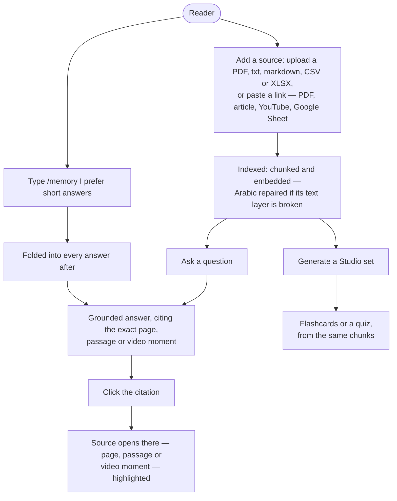

# NotebookLLM⁻
<p align="center">
  
</p>


<div align="center">

[](https://www.linkedin.com/in/omarrbakr/)[](mailto:bakro0298@gmail.com)[](https://leetcode.com/u/omar_bakr/)[](https://omartbakr.github.io/)

</div>

> **NotebookLLM-minus** — NotebookLM, minus the parts that aren't built yet.

**▶ [Watch the walkthrough](demo/walkthrough.gif)** ([full-quality video](demo/walkthrough.mp4)) — links, files and a
Google Sheet as sources, cited answers that open the exact page, row or moment, the model picker, and a mind map,
flashcards and quiz that do the same. ([Jump to the demo](#demo))

Add documents or links (PDFs, articles, YouTube videos, public Google Sheets), ask questions, get
answers grounded in *those* sources, with citations back to the page or moment they came from. A small, deliberately readable RAG backend on **FastAPI**,
with a web UI in English and Arabic.

Every backend is swappable from `.env` — chat model, embedding model, document store, vector
store — and the whole stack runs **offline against a local Ollama** if you want it to. Models
are discovered from what is actually installed and reachable, never pinned in code.

**[Documentation](docs/README.md)**: one page per feature · **[Diagrams](software_engineering/README.md)** ·
[Demo](#demo) · [Quickstart](#quickstart) · [Features](#features) · [Configuration](#configuration) ·
[Architecture](#architecture) · [Evaluation and load testing](#evaluation-and-load-testing) ·
[Development](#development)

## Demo


Recorded end to end against the running stack, in the light theme, with small sources only (a 15-page
paper, a 19-second video, one Arabic article, two tiny spreadsheets). Stretches that are only waiting for
the workers are fast-forwarded and labelled. In order:

1. **Add sources** — three by link (a YouTube video, an Arabic Wikipedia article, an arXiv PDF), a public
   Google Sheet, and a CSV and an XLSX from disk. The bar follows each link from the fetch through to the index.
2. **Ask, and open the citation** — a PDF answer cites its page and highlights the passage; a video answer
   opens the player at that moment; an Arabic question gets an Arabic answer with its own source.
3. **Spreadsheets** — one chunk per row; a salary lookup cites `team.csv · row 8` and a revenue question cites
   `sales.xlsx · Q1 Sales · row 6`, numbered as in Excel.
4. **Model picker** — filter the catalogue by provider down to OpenRouter's models, each with what it can do.
5. **Studio** — a mind map (expand a branch, open a topic's source), flashcards and a quiz, each opening the
   passage it was written from.
6. **Interface** — theme and English/Arabic switch.

A reader's path through it — what [the architecture page](docs/architecture.md) breaks into requests,
queues and prompts:



## Quickstart

```bash
cd Docker
cp -r env.example env           # per-service env files; fill in the REPLACE_ME values
docker compose up -d --build    # postgres profile: app, pgvector, nginx, prometheus, grafana
```

Then configure the app itself and run it:

```bash
cd src
cp .env.example .env            # every setting is documented in there
uv sync
uv run uvicorn main:app --reload
```

- UI and API: <http://localhost:8000> (`:8081` through nginx)
- Dashboards, traces, tasks and queues: the **Visualization** button in the app's top bar
- Directly: Grafana <http://localhost:3000/grafana/> · Flower <http://localhost:5555/flower/> ·
  RabbitMQ <http://localhost:15672/rabbitmq/> · Prometheus <http://localhost:9090> · Langfuse <http://localhost:3001>

Compose needs no `--env-file` flags. Mongo and Qdrant sit behind `--profile mongo`, Langfuse
behind `--profile langfuse`. More in [deployment](docs/features/15_deployment.md).

## Features

| Feature | In one line | Details |
| --- | --- | --- |
| Accounts | Email and password sign-in; every request answers only for the signed-in user's data | [01](docs/features/01_accounts_and_isolation.md) |
| Notebooks and sources | PDF, txt, markdown, CSV, XLSX, pictures, and links (PDF, article, YouTube, public Google Sheet); English and Arabic UI | [02](docs/features/02_notebooks_sources_and_ui.md) |
| Ingestion | Four queue-joined stages on Celery workers; resumable, idempotent, every run recorded | [03](docs/features/03_ingestion_pipeline.md) |
| OCR and Arabic repair | A model repairs damaged Arabic text layers; scanned pages are OCR'd; highlights survive | [04](docs/features/04_ocr_and_arabic_correction.md) |
| Chunking and citations | Citations open the exact page, passage, row or video moment, highlighted | [05](docs/features/05_chunking_and_citations.md) |
| Storage | Postgres + pgvector or MongoDB + Qdrant behind one set of repository interfaces | [06](docs/features/06_embeddings_and_vector_stores.md) |
| Models and providers | Seven chat and six embedding backends; a per-notebook picker built from what actually answers | [07](docs/features/07_models_and_providers.md) |
| Grounded chat | Every question is planned; a complex one is researched part by part, then combined | [08](docs/features/08_agentic_rag.md) |
| Reranking | A multilingual cross-encoder keeps the best passages; falls back to vector order | [09](docs/features/09_reranking.md) |
| Guardrails | A guard model checks the question and the streamed answer, micro-batched on Celery | [10](docs/features/10_guardrails.md) |
| Memory | `/memory …` stores a fact about the user, folded into every later answer | [11](docs/features/11_memory.md) |
| Studio | Mind map, flashcards and quiz from the notebook's own chunks, each item traceable | [12](docs/features/12_studio.md) |
| Observability | Langfuse traces, Prometheus, Grafana, Flower, structured logs; all opened inside the app from one Visualization button | [13](docs/features/13_observability.md) |
| Pictures as sources | Figures and uploaded pictures are captioned, embedded and cited; figures travel with their text | [14](docs/features/14_multimodal_retrieval.md) |
| Deployment | Docker Compose; `main` deploys when the suite is green | [15](docs/features/15_deployment.md) |
| Tests and code quality | A suite that needs no network, model or database; Black and Ruff on commit | [16](docs/features/16_tests_and_code_quality.md) |
| Evaluation and load | Ragas scores the running system's answers; Locust loads it with concurrent users | [17](docs/features/17_evaluation_and_load_testing.md) |

**Not yet:** web-search grounding, private Google Sheets, and the audio, slides, video and report
tiles in Studio. Each has a placeholder in [docs/roadmap](docs/roadmap/README.md).

## Configuration

`src/.env.example` documents every setting next to the values it accepts; a wrong value fails at
startup with the full list. The ones to set on day one:

| Setting | Does what |
| --- | --- |
| `DOCUMENT_DB_BACKEND` | `postgres` (+ pgvector, one service) or `mongo` (+ Qdrant) |
| `GENERATION_BACKEND` / `GENERATION_MODEL_ID` | the default chat model: `ollama`, `nvidia`, `openrouter`, `anthropic`, `openai`, `google`, `cohere` |
| `EMBEDDING_BACKEND` / `EMBEDDING_MODEL_ID` / `EMBEDDING_MODEL_SIZE` | the default embedder; the size **must match the model** |
| `OLLAMA_HOST` / `OLLAMA_PORT` | where `ollama serve` is listening |
| `<VENDOR>_API_KEY` | only for a backend you selected; a blank one stops the app at startup |
| `POSTPROCESS_ENABLED` / `POSTPROCESS_MODEL_ID` | repair extraction damage with a model at ingest |
| `RERANKER_ENABLED` | rerank retrieved passages with the `reranker` container |
| `GUARDRAILS_ENABLED` | check questions and answers with a guard model |
| `MULTIMODAL_ENABLED` | pictures as sources; needs Ollama 0.40+ and `embeddinggemma-2:440m-q8_0-text-vision` |
| `LANGFUSE_ENABLED` | one trace per answer, and versioned prompts |

Each feature page lists the settings that belong to it.

## Architecture

Three tiers, each talking only to the one below it: `presentation/` (HTTP and the UI),
`application/` (services, providers, Celery jobs) and `data/` (repositories), plus `shared/` for
settings, enums and exceptions. Nothing above `application/providers/` or `data/repositories/`
names a vendor, which is what makes every backend swappable from `.env`.

- [Architecture, project structure and the API table](docs/architecture.md)
- Whole-system [sequence diagram](software_engineering/3_sequence_diagrams/system_overview.png)
  and [class diagram](software_engineering/4_class_diagrams/system_overview.png)
- [How a document is ingested](docs/features/03_ingestion_pipeline.md) ·
  [how a question is answered](docs/features/08_agentic_rag.md)

## Evaluation and load testing

Two tools test the **running system** from the outside, over HTTP. They live in
[`evals/`](evals/README.md) with an environment of their own. Full write-up:
[evaluation and load testing](docs/features/17_evaluation_and_load_testing.md).

```bash
cp evals/.env.example evals/.env && uv sync --project evals
uv run --project evals python evals/ragas_eval.py                                    # answer quality
uv run --project evals locust -f evals/locustfile.py --host http://localhost:8081    # load
```

**Answer quality with [Ragas](docs/features/17_evaluation_and_load_testing.md#answer-quality-ragas).**
It uploads a dataset, asks each question through the same streaming endpoint the browser uses,
and has a judge model score the answers and the passages they cite. First baseline, 2026-11-12,
on the sample dataset (12 questions, all answered and scored; judge `llama3.1:8b` on local Ollama):

| Metric | Asks | Mean |
| --- | --- | --- |
| Faithfulness | is every claim supported by the cited passages? | 0.944 |
| Answer relevancy | does the answer address the question? | 0.903 |
| Context precision | are useful passages ranked above useless ones? | 0.968 |
| Context recall | do the passages hold what the reference answer needs? | 0.931 |
| Factual correctness | same facts as the reference answer? | 0.832 |

**Load with [Locust](docs/features/17_evaluation_and_load_testing.md#load-locust).** Simulated
signed-in users browse, search, ask and upload; tasks are tagged so cheap and expensive paths can
be loaded apart. First runs on the local compose stack:

| Run | Requests | Failures | Median | 95th percentile |
| --- | --- | --- | --- | --- |
| Browse and search, 8 users, 45 s | 203 | 0 | 9 ms | 59 ms |
| Full streamed answers, 2 users, 75 s | 7 | 0 | 13 s | 22 s |

A small sample on one machine: it shows the loop works and gives a number to compare the next
run against, not a benchmark. The
[measurements section](docs/features/17_evaluation_and_load_testing.md#first-measurements) has
the detail, including one open finding: answers currently reach the client in one piece.

## Development

```bash
python -m pytest -q                     # from the repository root
node --test tests/frontend/*.test.mjs   # the UI's pure modules
git config core.hooksPath .githooks     # Black and Ruff on commit, once per checkout
```

More in [tests and code quality](docs/features/16_tests_and_code_quality.md).
