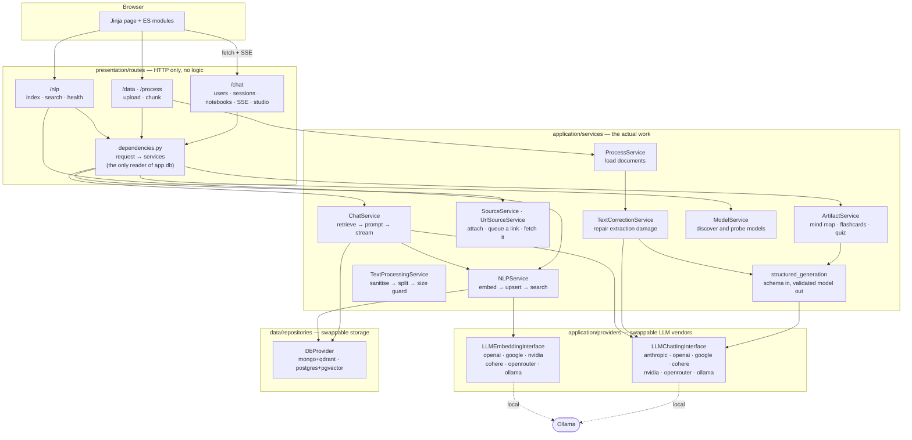

# Architecture

> UML for the whole system (user stories, use cases, sequence and class diagrams, PlantUML with
> rendered PNGs) lives in [`software_engineering/`](../software_engineering/README.md). The
> whole-system views are
> [the sequence diagram](../software_engineering/3_sequence_diagrams/system_overview.png) and
> [the class diagram](../software_engineering/4_class_diagrams/system_overview.png).

Three tiers, each talking only to the one below it, plus a `shared/` layer of cross-cutting
vocabulary and infrastructure that all three depend on. Nothing above `application/providers/`
or `data/repositories/` names a vendor, which is what makes the backends swappable from config.



The flows through these tiers are on the feature pages:
[ingesting a document](features/03_ingestion_pipeline.md),
[adding a link](features/02_notebooks_sources_and_ui.md#adding-a-link) and
[asking a question](features/08_agentic_rag.md). [`src/README.md`](../src/README.md) has the
rules each tier follows.

## Project structure

Three tiers, plus one cross-cutting layer nothing else depends on for its own sake:

```
src/
├── main.py                   # the API process entrypoint: app, lifespan, error handlers
├── celery_app.py             # the worker process entrypoint, sibling to main.py
├── celery_queues.py          # queue declarations and task routing
├── presentation/              # tier 1 — HTTP and the browser-facing UI
│   ├── dependencies.py          # request -> services; the only reader of app.db / app.providers
│   ├── routes/                 # HTTP only — base, data, process, nlp, ui
│   │   ├── chat/                 # users · sessions · chats · messages · assets · models · studio · memory
│   │   └── schemas/              # request models
│   ├── web/                    # templates/ and static/ sent to the browser
│   └── middleware/              # request logging
├── application/                # tier 2 — the actual work
│   ├── services/                 # the work, grouped: account · conversation (sessions, chats, messages, sources) · core · ingest · llm · memory · rag · studio
│   ├── providers/                 # LLM vendor adapters: chatting/, embedding/ (+ embedding/image/, the multimodal embedder), reranking/, provider_cache
│   ├── tasks/                     # Celery task bodies
│   │   ├── jobs/                    # ingest/ (plan · parse · postprocess · assemble · summarise) · index · studio · memory · maintenance
│   │   ├── runtime.py               # the resources and timeout handling every job shares
│   │   ├── tracking/                # task_executions rows, progress, status lookup
│   │   └── workflows.py             # the ids a run is published under
│   ├── prompts/                   # chat and studio prompts sent to the model, per language
│   ├── ocr_prompts/                # ingest-correction prompts sent to the model, per language
│   └── arabic_extraction/         # the OCR pipeline
├── data/                       # tier 3 — persistence
│   ├── models/                    # pydantic schemas + the thin XModel(db) adapters
│   └── repositories/               # mongo/ and postgres/ behind 12 repository ABCs, + alembic/
└── shared/                     # cross-cutting, used by all three tiers — not itself a tier
    ├── enums/                    # every .env choice, plus provider lookup tables
    ├── utils/                    # Settings, logging, metrics, model id vocabulary
    └── exceptions.py             # the domain exception hierarchy
Docker/                        # compose, nginx, prometheus, grafana dashboards
tests/                         # behavior-focused tests and shared support fakes
```

`application/prompts/` and `application/ocr_prompts/` answer different questions and stay two
separate resolvers on purpose: `prompts/` (chat and studio) answers *a user*, resolved from the
notebook's own language, where a missing key raises rather than silently answering an Arabic
question in English; `ocr_prompts/` answers *a document* during ingestion, where there is no
conversation and falling back to English is correct rather than a bug. They used to be named
`templates/` and `prompts/` — a collision with `web/templates/` (Jinja HTML, a different
audience entirely) that the current names exist to remove.

## API

Full interactive reference at `/docs`. The shape of it:

| Method | Path | |
| --- | --- | --- |
| `GET` | `/base/health` | app name and version |
| `GET` | `/nlp/health` | live probe — database, embedding model, vector store |
| `POST` | `/data/upload/{project_id}` | store a file as an asset |
| `POST` | `/process/{project_id}` | queue chunking for one asset, or every asset in the project |
| `GET` | `/process/tasks/{task_id}` | read queued processing state and result |
| `POST` | `/nlp/index/push/{project_id}` | embed a project's chunks and upsert them |
| `POST` | `/nlp/index/search/{project_id}` | ranked passages with citation metadata |
| `GET` | `/nlp/index/info/{project_id}` | collection name, size, width |
| `GET/POST/PATCH/DELETE` | `/chat/users…`, `/chat/users/{id}/sessions`, `/chat/sessions/{id}/chats` | profiles, sessions, notebooks |
| `POST` | `/chat/chats/{chat_id}/message` | ask a question — streams SSE. `image` (a data URL, PNG/JPEG/WebP, ≤ `IMAGE_QUERY_MAX_BYTES`) attaches a picture to it |
| `GET` | `/chat/chats/{chat_id}/messages` | transcript |
| `POST/GET/PATCH/DELETE` | `/chat/chats/{chat_id}/assets…` | a notebook's documents, content, rename, delete |
| `POST` | `/chat/chats/{chat_id}/sources/url` | add a link (PDF, article, YouTube, public Google Sheet) — `202` with the fetch task's id |
| `GET` | `/chat/chats/{chat_id}/assets/{asset_id}/chunks/{n}/locate` | where a citation sits on the page; `kind`, `linked_images` / `linked_chunks` for a figure or the passages tied to one |
| `GET` | `/chat/chats/{chat_id}/assets/{asset_id}/chunks/{n}/image` | the picture an image chunk shows, cut out of its source (`size` caps the longest side); 404 for a text chunk |
| `GET` | `/chat/chats/{chat_id}/indexing` | ingest progress, mid-upload; `next_task_id` when a task hands on to another |
| `GET` | `/chat/models` · `/chat/models/quick` | the catalogue the picker is built from (full probe · configured hosted models, no network calls) |
| `POST/GET` | `/chat/chats/{chat_id}/studio/{kind}` | generate a mind map, flashcards or quiz (`202`, or `200` with the id of the run already going) · read the latest set |
| `GET` | `/chat/chats/{chat_id}/memory?q=` | stored facts closest to *q*, for the composer's memory preview |
| `POST` | `/chat/chats/{chat_id}/documents` | attach a file to the notebook and queue its ingestion (`202`) |
| `GET` | `/chat/chats/{chat_id}/assets/{asset_id}/content` | the stored file, for the viewer (`image/*` for an uploaded picture) |
| `PATCH` | `/chat/chats/{chat_id}/models` | point a notebook at different models |
| `PATCH` | `/chat/chats/{chat_id}/settings` | temperature, output length, chunking, colour |

Asking a question streams newline-delimited JSON events — `meta` first (grounded flag and
citations, so sources paint before the first token), then `thinking` and `delta` pieces, then
`done`:

```bash
curl -N -X POST localhost:8000/chat/chats/$CHAT/message \
     -H 'content-type: application/json' -d '{"text": "what does it say about X?"}'
```

Switching a notebook's embedding model **rebuilds its index** — vector width is fixed when a
collection is created, so old vectors are unusable. The chunks are already stored, so the
rebuild re-embeds them rather than asking for the documents again.
