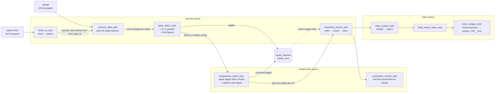

# Ingestion pipeline

## What it does

Turns an attached source into chunks and vectors on Celery workers, never inside the request.
Attaching answers `202 Accepted` with an `asset_id` and a `task_id`; the sources panel polls the
task until the last chunk is indexed. A 200-page PDF never holds an API process, a repeated
submission joins the run already in flight, and a worker restart resumes at the batch it had
reached.

## How it works

Four stages, joined by queues rather than by a Celery canvas. Nothing waits on a callback: each
stage hands off through a queue, and completion is a row count the database answers.

| Stage | Task | Module (`src/application/tasks/jobs/`) | Queue |
| --- | --- | --- | --- |
| Plan | `process_data_task` | `ingest/process.py` | process |
| Parse | `parse_batch_task` | `ingest/parse.py` | process |
| Correct, caption | `postprocess_batch_task` | `ingest/postprocess.py` | postprocess |
| Collect | `assemble_chunks_task` | `ingest/assemble.py` | process |
| Summarise | `summarise_chunks_task` | `ingest/summarise.py` | postprocess |
| Index | `index_project_task`, `build_vector_index_task`, `index_images_task` | `index.py` | index |

Four stages, joined by queues rather than by a Celery canvas. Nothing waits on a callback:
each stage hands off through a queue, and completion is a row count the database answers.



With `MULTIMODAL_ENABLED` the same four stages also carry the pictures. Parse records *where*
each figure sits (page, bounding box, the PDF's own image id) and keeps nothing else; a page
that is still empty after OCR but has something drawn on it becomes one picture. Postprocess
captions each one with a vision model, handing it the text printed next to the figure as
context. Assemble turns every figure into an **image chunk** after the text chunks, shaped
like a text chunk (`page`, a `highlight` in the same coordinate space, the caption as its
content) so citations, `/locate` and the PDF viewer's highlight box need no new code, and
then **links** it: a passage that names the figure's label ("Figure 3", "Fig. 3",
"الشكل ٣", Arabic-Indic digits included) links across pages; on the same page, passages
whose highlight rectangles sit directly above or below the figure link by distance, and
anything else on the page links weakly. The best few on each side are written into
`chunk_metadata` as `linked_images` / `linked_chunks`. The caption is indexed with the text,
so a plain text search finds a figure by what it says; the pixels are cut back out of the
stored asset whenever they are needed and embedded into a second collection per notebook,
`project_<id>__img`, independent of the chat's own text embedder.

The claim is the whole of the coordination: every batch asks whether it was the last, and one
atomic `UPDATE` answers yes exactly once. See [Background processing](03_ingestion_pipeline.md#background-processing)
for why that replaced a chord, and what the chord did instead.

### What takes which route

- **A PDF on `PDF_LOADER=pymupdf`** is split into page batches of `PDF_BATCH_PAGES`, parsed in
  parallel with word boxes, and reassembled in page order.
- **Everything else** (txt, markdown, CSV, XLSX, a YouTube transcript, an uploaded picture, a PDF
  on another loader) is one batch through `ProcessService.process_bytes`, with no word boxes.
- **Spreadsheets** are read row by row by `services/ingest/tabular.py`: one chunk per row, each
  value labelled with its column.

### Background processing

Ingestion runs in Celery rather than inside the FastAPI request. Attaching a document stores
the file and returns `202 Accepted` immediately with an `asset_id` and a `task_id`; chunking
and embedding then happen on the workers. A pasted link is one task earlier: `fetch_url_task`
fetches it, then attaches it the same way (see [Adding a link](02_notebooks_sources_and_ui.md#adding-a-link)).

**Ingesting a PDF is four stages joined by queues.** `process_data_task` plans the page
batches and publishes one `parse_batch_task` each; every parse stores its pages and queues a
`postprocess_batch_task`; whichever of those finishes last claims the run and dispatches
`assemble_chunks_task`, which chunks, stores, and publishes the indexing stage. Only the
correction stage gets a queue of its own — it is the only one that waits on a model rather
than a CPU, and behind an extraction on the shared queue one large document's corrections
would stall every other document's parsing.

**Completion is a row, not a callback.** This was a Celery chord and the chord did not work:
`self.replace(chord(group(chain(parse, postprocess)), assemble))` marked one of twenty-three
chain-tails as a chord member, its accumulator reached 1, and a 222-page book whose every
batch had succeeded produced no chunks at all — silently, with the results still sitting in
the result backend. It is now a count over `ingest_batches` and one atomic claim:

```sql
UPDATE ingest_runs SET collected_at = now()
WHERE asset_id = :a AND collected_at IS NULL
  AND (SELECT count(*) FROM ingest_batches
       WHERE asset_id = :a AND status = 'corrected') = total_batches
RETURNING asset_id
```

`collected_at IS NULL` makes it single-winner however many batches finish together; the
subquery in the same statement stops it firing early, where a count-then-claim could be told
23 of 23 and then claim after a retry had reset one. Unlike the chord it survives a worker
restart — rebuilding the containers mid-run resumes at the batch it had reached — and is
unbothered by redelivery.

**Only ids ride the queue.** A ten-page batch carries every word and bounding box of those
pages, which is megabytes. Through the broker that would make RabbitMQ a file server, and in
the result backend it would meet a 512 MB cap with an LRU eviction policy, so the payload goes
to `ingest_batches` and the message carries `(asset_id, batch_index)`. The rows are scratch:
the collector deletes them once the chunks are stored, and a row still present is an ingestion
that did not finish.

Progress is the same count — `done` over a unique `(asset_id, batch_index)` — which is what
makes it structurally incapable of passing the total. The Redis counter it replaced was an
unbounded `INCR`, and one redelivered task pushed a progress bar to 104%.

**Every run is recorded.** `task_executions` holds one row per task — name, arguments, status,
stage, progress, trimmed result, timings — so history survives the Redis result TTL, can be
joined to the project it acted on, and is what the browser's progress bar polls. Celery's own
state cannot do any of that, and cannot report a task whose worker was killed: that row would
say `STARTED` forever, because the process that would have written the ending is gone.

Statuses are `QUEUED`, `STARTED`, `SUCCESS`, `FAILURE` and `DEAD`. The last has no Celery
equivalent and is the point of the table — work cancelled because the stage ahead of it
failed, or abandoned when its worker vanished.

**Repeat submissions join the run in progress.** `IdempotencyService` fingerprints
`(task_name, args)` and returns `200` with the existing `task_id` instead of `202`, so a
double-click does not pay for the same embedding twice. It is a query rather than a unique
constraint by choice: both tasks are already re-runnable — processing skips assets that are
already chunked, indexing upserts on a deterministic point id — so a constraint would turn a
harmless race into a `500` rather than preventing anything that matters.

The workloads are isolated into `process`, `postprocess`, `index` and `maintenance` queues.
Parse, plan and collect share the `process` queue: a queue absent from a worker's `-Q` list
has no consumer, and a task published to it sits `QUEUED` for ever with no error to say so. Session CRUD,
listings, health checks and semantic reads remain in FastAPI because they are short
transactional or streaming operations and do not benefit from an extra broker round trip.

The API and workers must share the same broker and result backend. From `src/`:

```bash
uv run celery -A celery_app.celery_app worker -Q "$CELERY_PROJECT_NAME.process_data_task" --loglevel=INFO
uv run celery -A celery_app.celery_app worker -Q "$CELERY_PROJECT_NAME.postprocess_batch_task" --loglevel=INFO --concurrency=2
uv run celery -A celery_app.celery_app worker -Q "$CELERY_PROJECT_NAME.index_project_task" --loglevel=INFO --concurrency=1
uv run celery -A celery_app.celery_app worker -Q "$CELERY_PROJECT_NAME.maintenance_task" --loglevel=INFO --concurrency=1
uv run celery -A celery_app.celery_app beat --loglevel=INFO
```

Compose runs the same set as `celery-process`, `celery-postprocess`, `celery-index`,
`celery-studio`, `celery-memory`, `celery-maintenance` and `celery-beat`. The process worker
passes no `--concurrency`: it takes it from `CELERY_WORKER_CONCURRENCY`, which defaults to one
per available CPU — a CLI flag would override the setting, and a compose shell cannot read a
cgroup quota.

**The sweep.** `maintenance_task` runs every `CELERY_MAINTENANCE_INTERVAL_HOURS` (default 24)
and does two things: marks work that can no longer be running as `DEAD`, and deletes finished
rows older than `CELERY_TASK_RETENTION_DAYS` (default 7). Two cutoffs, because the two failures
differ. A run that started longer ago than twice the hard time limit is definitionally not
running. Queued work gets the full retention window instead — a task waits legitimately for as
long as its workers are down, and a tight cutoff would report a deploy as data loss.

Broker and result-backend connection failures are the `CeleryError` branch of the exception
hierarchy and return `503`. A task's own failure stays in its row and its result, with the
exception type alongside the message.

## Settings

| Setting | Does what |
| --- | --- |
| `PDF_LOADER` | `pymupdf` (default, the only loader with word boxes) · `pypdf` · `pdfplumber` |
| `PDF_BATCH_PAGES` | pages per queue message: one unit of parsing, and of retry |
| `CELERY_WORKER_CONCURRENCY` | parse batches in flight per worker. `0` = one per available CPU |
| `INGEST_SUMMARISE` | write one-line chunk summaries after ingest, so Studio starts warm |
| `CELERY_TASK_TIME_LIMIT` | hard limit per task; the sweep's "abandoned" cutoff is twice this |
| `CELERY_MAINTENANCE_INTERVAL_HOURS` / `CELERY_TASK_RETENTION_DAYS` | how often the sweep runs, and how long finished rows are kept |
| `CELERY_QUEUE_*` | queue names; each must match a worker's `-Q` |

**On `PDF_LOADER`.** Measured on a 274-page Arabic document: `pypdf` 29s and ~90k lost glyphs,
`pdfplumber` 52s and right-to-left text in *visual* order (reversed: not one real Arabic word
survives), `pymupdf` no lost glyphs at all. pymupdf is the default and the only one that captures
the word coordinates a citation highlight is drawn from; it is also much slower, which
`PdfLayoutService` offsets by extracting pages across a process pool.

## API

| Method | Path | |
| --- | --- | --- |
| `POST` | `/chat/chats/{chat_id}/documents` | attach a file and queue its ingestion (`202`) |
| `GET` | `/chat/chats/{chat_id}/indexing` | ingest progress; `next_task_id` when a task hands on to another |
| `POST` | `/process/{project_id}` | queue chunking for one asset, or every asset in the project |
| `GET` | `/process/tasks/{task_id}` | a queued run's state and result |
| `POST` | `/nlp/index/push/{project_id}` | embed a project's chunks and upsert them |

## Data

`ingest_runs` and `ingest_batches` are scratch: the collector deletes the batch rows once the
chunks are stored. `task_executions` is the durable record of every run. See
[storage](06_embeddings_and_vector_stores.md#data-model).

## Tests

`tests/ingestion/test_batched_ingest.py`, `test_parse_policy.py`, `test_fetch_task.py`,
`test_index_build.py`, `tests/tasks/`, `tests/api/test_documents.py`, `test_process.py`,
`test_index_queueing.py`. `tests/support/ingest.py` runs the real stage bodies in-process against
the fakes.

## Diagrams

[Upload → ingest → index](../../software_engineering/3_sequence_diagrams/upload_ingest.png) · [user stories](../../software_engineering/1_user_stories/02_sources_and_ingest.png) ·
[use cases](../../software_engineering/2_use_case_diagrams/sources_and_ingest.png) · [Celery jobs](../../software_engineering/4_class_diagrams/guardrails_and_tasks.png)

## Known limits

- The `/data/upload/{project_id}` route still stores a file through the older
  `DataService.store_upload`, without the dedupe check `/chat/.../documents` has. See
  [cleanup follow-ups](../roadmap/cleanup_followups.md).
- Pages per OCR call are not batched yet: [OCR batching](../roadmap/ocr_batch_pages_per_call.md).
