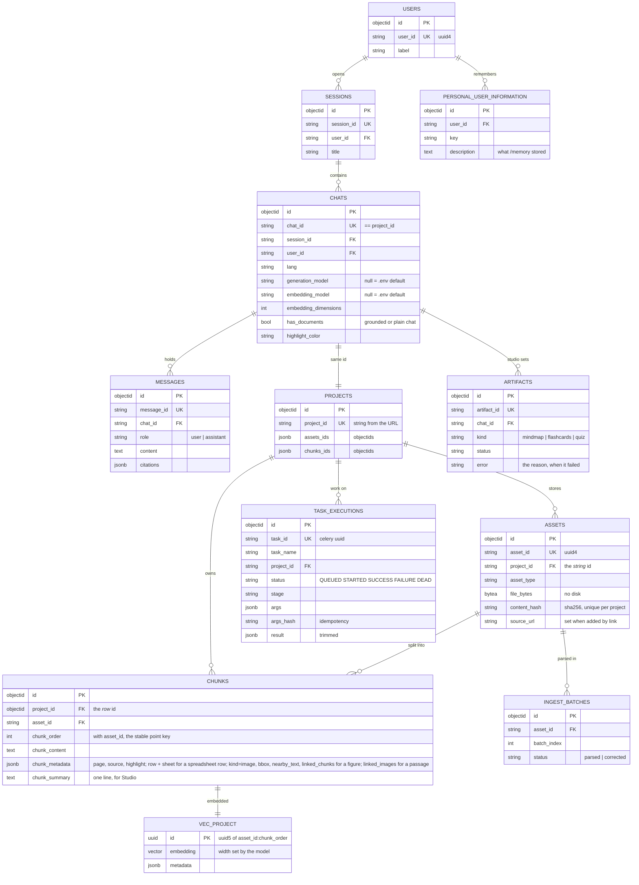

# Storage: documents, embeddings and vector stores

## What it does

Keeps users, notebooks, messages, assets and chunks in one of two interchangeable document
stores, and their vectors beside them. Every chunk is embedded once with the notebook's own
embedding model; a question is embedded the same way and matched against that notebook's
collection only.

## How it works

- **Repositories.** `src/data/repositories/interfaces/` declares the repository ABCs and the
  `DbProvider` that hands them out; `mongo/` and `postgres/` implement them. Services reach a
  store only through `data/models/` (`ChunkModel(db)`, `AssetModel(db)`, …), thin factories over
  the provider. `tests/persistence/test_backend_contract.py` holds both backends to the same
  contract.
- **Indexing.** `NLPService` (`src/application/services/rag/NLPService.py`) embeds chunks in
  batches of `CHUNKING_BATCH_SIZE` and upserts them. Point ids are
  `uuid5(asset_id + chunk_order)`, stable across re-processing, so re-indexing overwrites in
  place instead of orphaning vectors.
- **One collection per notebook.** `chat_id` **is** the `project_id`, so a notebook is its own
  document space. The vector width is fixed when a collection is created, which is why switching
  a notebook's embedding model rebuilds its index from the stored chunks.
- **Embeddings are batch-first**, and two failures are caught at the boundary: a count mismatch
  and a width mismatch against `EMBEDDING_MODEL_SIZE`. See
  [models and providers](07_models_and_providers.md).
- **Pictures** have a second collection per notebook, `project_<id>__img`. See
  [multimodal retrieval](14_multimodal_retrieval.md).

### Database backends

`DOCUMENT_DB_BACKEND` picks the store behind users, sessions, notebooks, messages, projects,
assets and chunks. Both implement the same repository interfaces, so nothing above `app.db`
knows which is running.

| | `mongo` | `postgres` |
| --- | --- | --- |
| Documents | MongoDB via `motor` | PostgreSQL via SQLAlchemy 2.0 + `asyncpg` |
| Vectors | Qdrant, a second service | pgvector, in the same database |
| Schema | implicit; indexes ensured at startup | explicit; owned by Alembic |
| Services | two | one |

They are not interchangeable at runtime — each keeps its own data, and switching the setting
points the app at a different store rather than migrating anything. The Postgres DSN is
assembled from `POSTGRES_HOST/PORT/USER/PASSWORD/DB`, credentials percent-encoded, so there
is no `DATABASE_URL` to keep in sync and no password in a committed file.

### Migrations

Tables are declared once as SQLAlchemy models in `data/repositories/postgres/base_repository.py`.
Alembic reads that metadata and every repository queries the same classes, so a column that
does not exist is an `AttributeError` at import rather than a 503 on first request.

Nothing needs running by hand: `alembic upgrade head` runs during the app's lifespan under a
Postgres advisory lock, so several workers booting at once cannot race. To drive it yourself,
from `src/` (the config lives beside the backend it migrates, hence `-c`):

```bash
uv run alembic -c data/repositories/postgres/alembic.ini upgrade head
uv run alembic -c data/repositories/postgres/alembic.ini revision --autogenerate --rev-id 0008 -m "…"
```

Revision ids are numbered by hand so `ls versions/` reads in order. **An autogenerate run
against a database already at head must produce an empty migration** — that is the check this
arrangement exists to make possible; if it is not empty, the models and the database have
drifted.

`0001` creates everything with `IF NOT EXISTS` so a database predating Alembic is adopted in
place. What that cannot do is reconcile a table that exists with the *wrong shape* — it skips
the whole table, columns and all — which is what `0002` exists for, after every read of a
user's sessions failed with `UndefinedColumnError`. Anything column-level needs its own
migration. Thirteen so far: initial schema, sessions reconcile, asset content hash, chunk lookup
index, notebook highlight colour, task executions, unique asset content, chunk summaries,
Studio artifacts, ingest batches, personal user information, asset source URL, accounts.

`0007` finally enforces one copy of a document per notebook — the index the dedupe lookup has
claimed to use since `0003`, deferred three times because the databases held duplicates and
choosing which copy to keep is not a migration's decision. It deduplicates nothing: it checks,
and stops with a message naming the offending rows if any remain.

**pgvector collections are not Alembic's.** One table per notebook, `vec_<collection>`,
created at runtime — the vector width is not known until an embedding model is chosen, and a
shared table would mean one fixed width for everyone. Alembic creates the extension; the
repository creates the tables. `env.py`'s `include_name` hook excludes them from the
autogenerate diff, without which every run proposed dropping every vector in the database.

### Data model



Two things in that diagram are worth internalising early, because both have caused real
bugs. `Project.project_id` is the **string** from the URL while `DataChunk.project_id` is the
project's **`_id`** — the same field name meaning two different things one table apart. And
`VEC_PROJECT` is not one table: it is one per notebook, `vec_<collection>`, created at runtime
because the vector width is not known until an embedding model is chosen.


| Collection | Key fields |
| --- | --- |
| `projects` | `project_id` (string, from the URL), `assets_ids`, `chunks_ids` |
| `assets` | `asset_id` (uuid4), `asset_type`, `project_id`, `file_bytes`, `content_hash` |
| `data_chunks` | `project_id` (**ObjectId**), `asset_id`, `chunk_order`, `chunk_content` |
| `task_executions` | `task_id` (Celery uuid), `task_name`, `project_id`, `status`, `stage`, `args_hash` |

The same pydantic documents back both stores; on Postgres they are tables of the same names
(`data_chunks` becomes `chunks`). The identifier distinction is worth internalising early:
`Project.project_id` is the string from the URL, while `DataChunk.project_id` is the
project's `_id`. Primary keys stay 24-hex `ObjectId` strings on Postgres too, because the
models are shared with the Mongo backend.

`task_executions` is the one table that is not part of that tree — it records work rather
than content, and is keyed by the Celery task id. Its `result` is stored trimmed: processing
returns the full text of every chunk it created, and keeping that would copy each ingested
document into the table a second time, so the counts are kept and the bodies dropped.

Users → sessions → notebooks → messages, with assets and chunks hanging off a notebook.
Nothing cascades in either store, so deletion routes walk the tree themselves, derived-first
at every level — a partial failure leaves a source visibly listed rather than leaving vectors
that outlived it.

## Settings

| Setting | Does what |
| --- | --- |
| `DOCUMENT_DB_BACKEND` | `mongo` (+ Qdrant) or `postgres` (+ pgvector, one service) |
| `POSTGRES_HOST/PORT/USER/PASSWORD/DB` | the Postgres DSN is assembled from these, credentials percent-encoded |
| `MONGO_HOST/PORT/USER/PASSWORD`, `MONGO_DB_NAME` | the same for MongoDB |
| `VECTOR_DB_HOST` / `VECTOR_DB_PORT` / `VECTOR_DB_API_KEY` | Qdrant, on the mongo backend |
| `VECTOR_DB_DISTANCE_METHOD` / `VECTOR_DB_INDEX_TYPE` | similarity metric and index kind |
| `EMBEDDING_BACKEND` / `EMBEDDING_MODEL_ID` / `EMBEDDING_MODEL_SIZE` | the default embedder; the size **must match the model** |
| `CHUNKING_BATCH_SIZE` | chunks embedded per request |

## API

| Method | Path | |
| --- | --- | --- |
| `GET` | `/nlp/health` | live probe: database, embedding model, vector store |
| `POST` | `/nlp/index/search/{project_id}` | ranked passages with citation metadata |
| `GET` | `/nlp/index/info/{project_id}` | collection name, size, width |
| `PATCH` | `/chat/chats/{chat_id}/models` | point a notebook at different models (rebuilds the index on a new embedder) |

## Tests

`tests/persistence/` (both backends, field mapping, the vector index, the Mongo provider's
connection), `tests/contracts/test_db_schema.py`, `tests/api/test_nlp.py`.

## Diagrams

[Data tier: providers, repositories, models](../../software_engineering/4_class_diagrams/data_repositories.png)

## Known limits

- `/memory` is stored on Postgres only: [memory on Mongo](../roadmap/memory_on_mongo.md).
- The two backends are not interchangeable at runtime; switching the setting does not migrate data.
